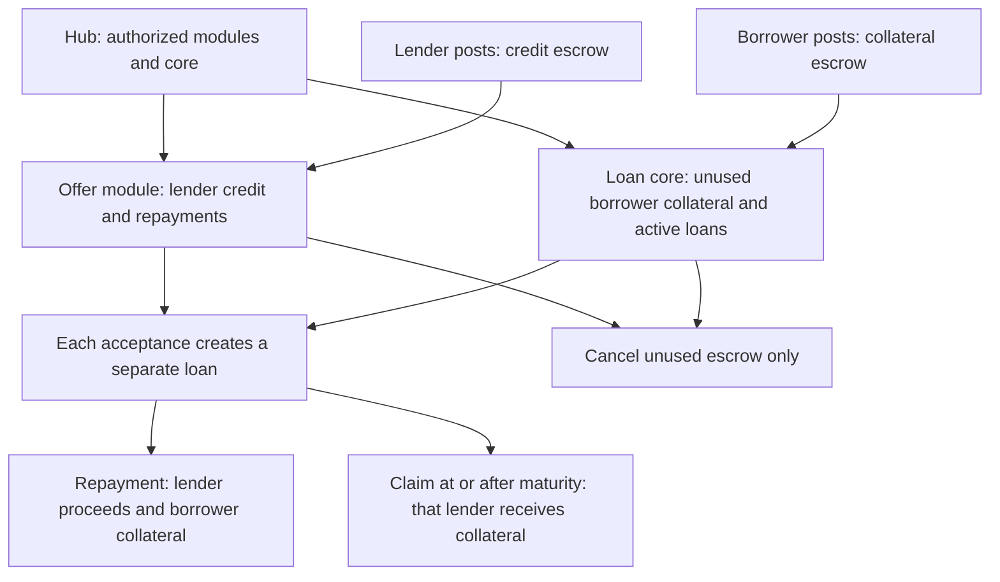

# PWN lending — Aleo PoC

Leo 4.4.2, protocol revision 0.4. Both lenders and borrowers can create offers
with multiple fills. Offers can be public or restricted to a privately designated
counterparty. Every fill creates an independent fixed-term loan.

Native ALEO, ARC-20 and the pinned USDCx/USAD compliance ABI are supported in
either asset role, without administrative asset admission. There is no frontend
or production SDK. The existing Python harness exercises the contracts locally.

Programs: `pwn_config_poc`, `pwn_hub_poc`, `pwn_loan_poc` and
`pwn_proposal_poc`. Generate them with `make build`; do not edit generated Leo.
Revision 0.4 changes interfaces/storage and requires fresh deployments. It is not
a migration of the earlier testnet programs.



The maker deposits credit or collateral at posting. The counterparty supplies
the other asset at acceptance. Repayments do not reopen capacity. A borrower
offer can have several lenders, so each loan has separate repayment rights.
Repayment remains possible after maturity until a lender's claim settles.

Private offers hide the opening before acceptance, not subsequent loan economics.
Public borrower terms are discoverable on-chain, but acceptance also needs an
off-chain opening containing the payout recipient. Makers can be offline once
the prospective acceptor has that payload. See [PRIVACY.md](PRIVACY.md).

## Run

```sh
make setup       # install the declared, pinned Leo 4.4.2 tool
make build       # generate and compile
make check       # unit, compatibility, arithmetic, lifecycle, invariants, security, offers
make allowance   # isolated public-USDCx allowance experiment; not a production loan
```

Suites use a local devnode and published development credentials. They share a
staged workspace and must run sequentially. Reports distinguish generated proofs
from node verification. See [docs/TESTING.md](docs/TESTING.md).

The core dynamically calls approved offer modules and has no static import of a
particular module. New modules must implement this revision's interface; new
settlement models may require a new interface/core version.

## Documents

- [MULTITOKEN.md](MULTITOKEN.md): interfaces, capacity, custody, rounding and timing.
- [INTERFACES.md](INTERFACES.md): agreed behavior and remaining production decisions.
- [PRIVACY.md](PRIVACY.md): disclosure and payload requirements.
- [SECURITY-REVIEW.md](SECURITY-REVIEW.md): invariants and unresolved issuer risks.
- [Funding at acceptance](research/funding-at-acceptance.md): tested allowance route and its limits.
- [Revision validation](docs/REVISION-0.4-VALIDATION.md): delivered changes, checks and deployment boundary.
- [Grant proposal](https://docs.google.com/document/d/1U5hCfMvDNpywJMmi3pvsk516FKDVI3JKPX0qUmsEmls/edit), [submission PDF](docs/grant-submission.pdf), [market evidence](research/grant-market-evidence.md).
- [archive/](archive/README.md): historical single-pair public-testnet evidence.
- [research/](research/SEMANTICS.md), [vendor/README.md](vendor/README.md): source provenance.

The production SDK, encrypted delivery/recovery, wallet integration, external
audit and immutable mainnet deployment remain grant work. GPL-3.0-only.
